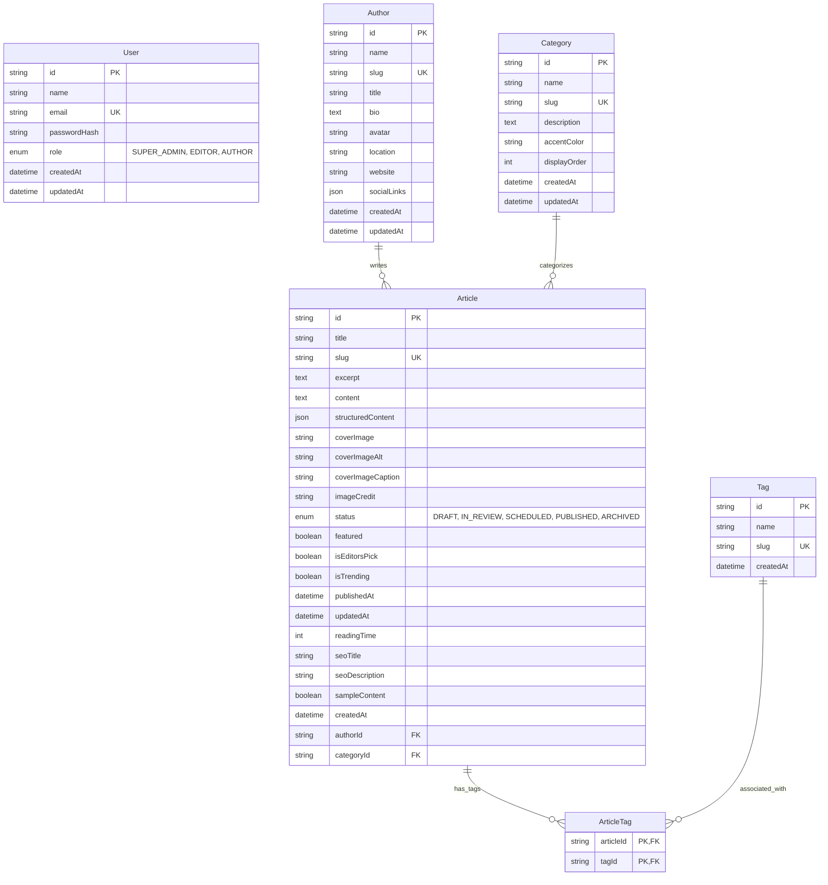

# Saudi Future Tech — Database Design & Schema Specification

**Document Version:** 2.0.0  
**Phase:** Phase 4 (Database Foundation & Content Data Migration)  
**Status:** Implemented & Verified in PostgreSQL  
**Database Engine:** PostgreSQL 16+  
**ORM:** Prisma 6.4.1  

---

## 1. Entity-Relationship Diagram (ERD)



---

## 2. Implemented Database Models

### 2.1. User Model
Prepared for administrative authentication in Phase 5.
- `id` (String, PK, CUID)
- `name` (String): Full name of the team member.
- `email` (String, Unique): Work email for login.
- `passwordHash` (String, Optional): Bcrypt / Argon2 hash (provisioned in Phase 5).
- `role` (Enum `UserRole`: `SUPER_ADMIN`, `EDITOR`, `AUTHOR`, default `AUTHOR`).
- `createdAt` / `updatedAt` (DateTime).

### 2.2. Author Model
Represents journalistic bylines and public contributor profiles.
- `id` (String, PK, CUID).
- `name` (String): Display name of the journalist.
- `slug` (String, Unique): URL-friendly slug (`/author/[slug]`).
- `title` (String): Editorial role/beat (e.g. "Senior Deep Tech Analyst").
- `bio` (Text, Optional): Biography describing reporting domain and background.
- `avatar` (String, Optional): High-resolution profile portrait URL.
- `location` (String, Optional): Reporting base (e.g. "Riyadh, Saudi Arabia").
- `website` (String, Optional): Personal portfolio or verified publication page.
- `socialLinks` (JSON, Optional): Key-value pairs for verified X/Twitter and LinkedIn accounts.
- `createdAt` / `updatedAt` (DateTime).
- Relational link: `articles Article[]` (One-to-many).

### 2.3. Category Model
Represents the six primary editorial pillars.
- `id` (String, PK, CUID).
- `name` (String): Pillar display title (e.g. "AI & Deep Tech").
- `slug` (String, Unique): URL slug (`/category/[slug]`).
- `description` (Text, Optional): Editorial mandate and coverage remit.
- `accentColor` (String, Optional): Hex color token (e.g. `#F4C542`).
- `displayOrder` (Int, Default 0): Sort order for navigation menus and section grids.
- `createdAt` / `updatedAt` (DateTime).
- Relational link: `articles Article[]` (One-to-many).

### 2.4. Article Model
The core publication model storing editorial teardowns, news, and investigative reports.
- `id` (String, PK, CUID).
- `title` (String): Full headline.
- `slug` (String, Unique): Canonical URL slug (`/article/[slug]`).
- `excerpt` (Text): Standfirst summary.
- `content` (Text): Full markdown or plain-text representation (indexed for search).
- `structuredContent` (JSON, Optional): Structured array of `ArticleSection` objects storing subtitles, pull quotes, technical comparison tables, and architectural takeaways.
- `coverImage` (String): Primary hero photo URL.
- `coverImageAlt` (String, Default ''): Accessible alt description.
- `coverImageCaption` (String, Optional): Contextual photo caption.
- `imageCredit` (String, Optional): Photo credit and licensing attribution.
- `status` (Enum `ArticleStatus`: `DRAFT`, `IN_REVIEW`, `SCHEDULED`, `PUBLISHED`, `ARCHIVED`, default `DRAFT`).
- `featured` (Boolean, Default false): Primary lead feature flag for homepage hero.
- `isEditorsPick` (Boolean, Default false): Flag for 3-column curated analysis section.
- `isTrending` (Boolean, Default false): Flag for the 48-Hour Velocity Index rail.
- `publishedAt` (DateTime, Optional): Official publication timestamp.
- `updatedAt` (DateTime): Last modification timestamp.
- `readingTime` (Int, Default 5): Estimated reading time in minutes.
- `seoTitle` / `seoDescription` (String, Optional): OpenGraph and search meta tags.
- `sampleContent` (Boolean, Default true): Explicit demonstration label.
- Foreign keys: `authorId` -> `Author(id)` (Restrict delete), `categoryId` -> `Category(id)` (Restrict delete).
- Relational link: `articleTags ArticleTag[]`.

### 2.5. Tag Model
Taxonomy tags and sub-beat topics.
- `id` (String, PK, CUID).
- `name` (String): Display tag name (e.g., "ALLaM LLM", "Zero Trust").
- `slug` (String, Unique): Tag slug.
- `createdAt` (DateTime).
- Relational link: `articleTags ArticleTag[]`.

### 2.6. ArticleTag Model
Many-to-many join table between `Article` and `Tag`.
- `articleId` (String, PK, FK -> Article).
- `tagId` (String, PK, FK -> Tag).
- Cascade deletion: Deleting an article or tag removes the corresponding join record without orphaned foreign keys.

---

## 3. Database Indexes

To maintain sub-10ms query execution across growing archives, the following multi-column and unique indexes are established:

```sql
-- Fast slug resolution
CREATE UNIQUE INDEX "Article_slug_key" ON "Article"("slug");
CREATE UNIQUE INDEX "Category_slug_key" ON "Category"("slug");
CREATE UNIQUE INDEX "Author_slug_key" ON "Author"("slug");
CREATE UNIQUE INDEX "Tag_slug_key" ON "Tag"("slug");

-- Feed and latest queries
CREATE INDEX "Article_status_publishedAt_idx" ON "Article"("status", "publishedAt" DESC);

-- Category and author archive filtering
CREATE INDEX "Article_categoryId_status_idx" ON "Article"("categoryId", "status");
CREATE INDEX "Article_authorId_status_idx" ON "Article"("authorId", "status");

-- Homepage curated feature queries
CREATE INDEX "Article_featured_status_idx" ON "Article"("featured", "status");
CREATE INDEX "Article_isEditorsPick_status_idx" ON "Article"("isEditorsPick", "status");

-- Taxonomy join traversal
CREATE INDEX "ArticleTag_tagId_idx" ON "ArticleTag"("tagId");
CREATE INDEX "ArticleTag_articleId_idx" ON "ArticleTag"("articleId");
```

---

## 4. Migration & Schema Validation

- **Prisma Schema File:** `prisma/schema.prisma`
- **Initial Migration:** `prisma/migrations/20261114141326_init/migration.sql`
- **Validation:** Executed and passed via `npx prisma validate`.
