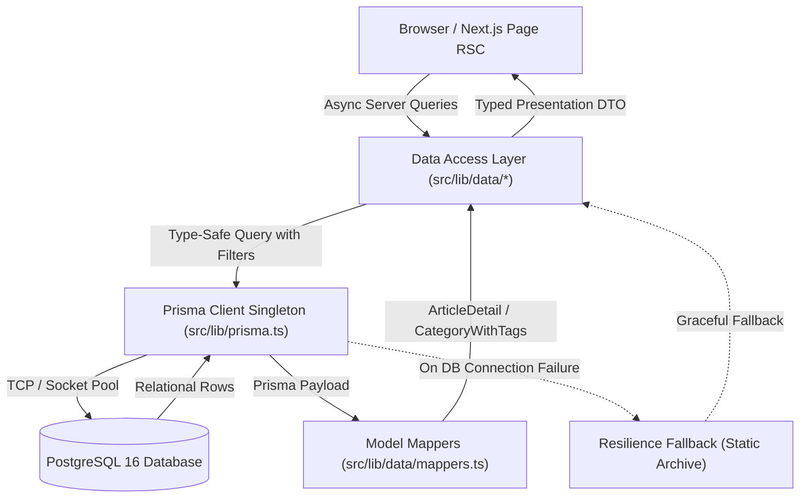

# Saudi Future Tech — Data Access Layer Architecture

**Phase:** Phase 4 (Database Foundation & Content Data Migration)  
**Location:** `src/lib/data/`  
**ORM:** Prisma 6.x / PostgreSQL 16+  

---

## 1. Architectural Philosophy

The Data Access Layer serves as the strict boundary between persistence models (PostgreSQL tables via Prisma) and presentation components (React Server Components and Client Components).



### Key Architectural Tenets:
1. **Presentation Decoupling:** UI components (`ArticleCard`, `FeaturedArticleCard`, `ReadingProgressBar`, etc.) never query Prisma directly. They consume clean TypeScript interfaces (`ArticleDetail`, `ArticlePreview`, `CategoryWithTags`, `AuthorItem`).
2. **Strict Privacy by Default:** Every public article query enforces `{ status: 'PUBLISHED' }`. Drafts, in-review pieces, and archived stories cannot be retrieved through public queries or direct slug lookups.
3. **Resilience & Fallback Strategy:** If PostgreSQL becomes temporarily unreachable during local testing, queries catch the error gracefully and fall back to the typed static archive, logging an operational warning rather than crashing Next.js.
4. **Caching & Revalidation:** Next.js App Router Incremental Static Regeneration (`export const revalidate = 60`) caches page responses at the edge and revalidates in the background every 60 seconds.

---

## 2. Directory Structure

```
src/lib/data/
├── articles.ts       # Queries for articles, hero, secondary grid, editor's picks, related, search
├── categories.ts     # Queries for editorial pillars, tags, and category slugs
├── authors.ts        # Queries for contributor profiles, author archives, and author slugs
├── mappers.ts        # Pure transformation functions converting Prisma models to presentation types
└── index.ts          # Central barrel export for all data functions
```

---

## 3. Data Access Functions Reference

### Article Queries (`src/lib/data/articles.ts`)

| Function Signature | Parameters | Description |
| :--- | :--- | :--- |
| `getArticleBySlug(slug: string)` | `slug: string` | Fetches a single published article with author, category, sections, and tags. Returns `null` if not found or if status is not `PUBLISHED`. |
| `getAllPublishedArticles()` | None | Fetches all published articles sorted chronologically by `publishedAt DESC`. |
| `getFeaturedArticle()` | None | Fetches the primary lead story flagged with `featured = true` and `status = 'PUBLISHED'`. |
| `getSecondaryArticles(limit = 4)` | `limit?: number` | Fetches secondary non-featured stories for the homepage asymmetrical sub-hero grid. |
| `getEditorsPickArticles(limit = 4)` | `limit?: number` | Fetches articles marked with `isEditorsPick = true`. |
| `getTrendingArticles(limit = 5)` | `limit?: number` | Fetches the top 5 trending articles ordered by velocity flags and publication date. |
| `getArticlesByCategory(categorySlug: string)` | `categorySlug: string` | Fetches published articles in a given category. |
| `getArticlesByAuthor(authorSlug: string)` | `authorSlug: string` | Fetches published articles by a specific journalist slug. |
| `getRelatedArticles(currentSlug, categorySlug, limit = 3)` | Current slug, category slug, limit | Fetches companion articles in the same pillar, excluding the active article. |
| `searchArticles(query: string, categorySlug?: string)` | Search term, optional category filter | Executes a case-insensitive PostgreSQL query across title, excerpt, content, tags, author, and category. |
| `getAllArticleSlugs()` | None | Fetches all published article slugs for Next.js `generateStaticParams`. |

### Category Queries (`src/lib/data/categories.ts`)

| Function Signature | Parameters | Description |
| :--- | :--- | :--- |
| `getAllCategories()` | None | Fetches all 6 categories ordered by `displayOrder ASC` with active article counts and tags. |
| `getCategoryBySlug(slug: string)` | `slug: string` | Fetches a single category with its published articles and sub-beat tags. |
| `getAllCategorySlugs()` | None | Fetches all category slugs for Next.js `generateStaticParams`. |

### Author Queries (`src/lib/data/authors.ts`)

| Function Signature | Parameters | Description |
| :--- | :--- | :--- |
| `getAllAuthors()` | None | Fetches all active editorial contributors sorted alphabetically. |
| `getAuthorBySlug(slug: string)` | `slug: string` | Fetches a single author profile by slug. |
| `getAllAuthorSlugs()` | None | Fetches all author slugs for Next.js `generateStaticParams`. |

---

## 4. Full-Text Search Implementation

The search implementation operates through `searchArticles(query, categorySlug)` in `src/lib/data/articles.ts`, mirrored by the dynamic API route at `src/app/api/search/route.ts`.

It utilizes PostgreSQL case-insensitive pattern matching (`mode: 'insensitive'`) combined with relational joins:

```typescript
const whereClause = {
  status: 'PUBLISHED',
  ...(categorySlug && categorySlug !== 'all' ? { category: { slug: categorySlug } } : {}),
  ...(normalizedQuery ? {
    OR: [
      { title: { contains: normalizedQuery, mode: 'insensitive' } },
      { excerpt: { contains: normalizedQuery, mode: 'insensitive' } },
      { content: { contains: normalizedQuery, mode: 'insensitive' } },
      { author: { name: { contains: normalizedQuery, mode: 'insensitive' } } },
      { category: { name: { contains: normalizedQuery, mode: 'insensitive' } } },
      {
        articleTags: {
          some: {
            tag: { name: { contains: normalizedQuery, mode: 'insensitive' } },
          },
        },
      },
    ],
  } : {}),
};
```

This guarantees fast, unified search results across title, excerpt, markdown body, author names, categories, and topic tags with zero external SaaS dependencies.

