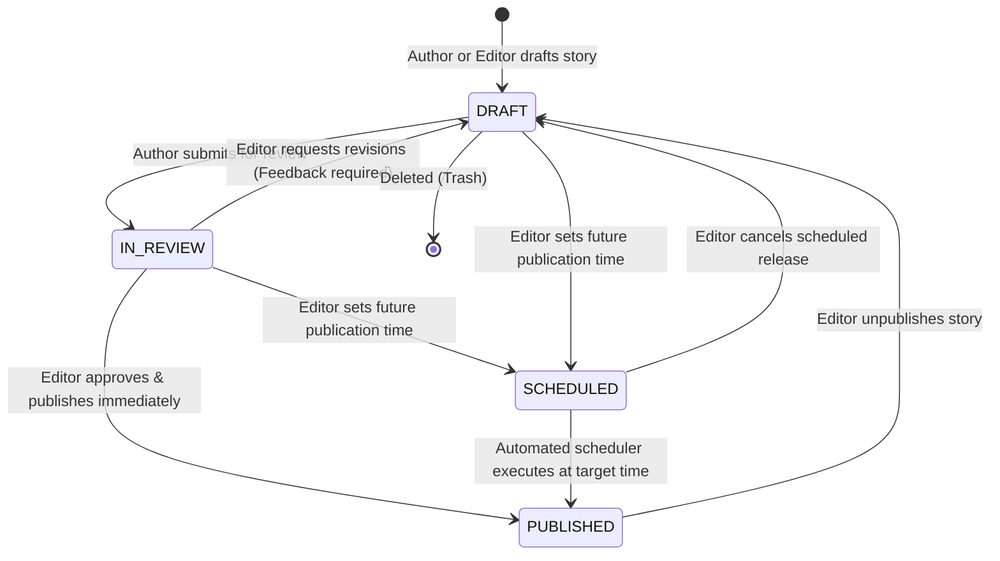

# Editorial Publishing Workflow & Review Audit Trail

**Saudi Future Tech** — [https://saudifuturetech.com](https://saudifuturetech.com)  
**Publication Focus:** Technology news, sovereign computing, AI, and Vision 2030 developments.  
**System Component:** Multi-Stage Editorial Review Workflow & State Machine

---

## 1. Overview & Workflow Objectives

The Saudi Future Tech publishing workflow provides a structured, professional editorial pipeline that balances contributor autonomy with strict editorial quality control. The workflow ensures that:

1. **Independent Journalists (Authors)** can draft stories, save work in progress, and formally submit completed reports to the editorial desk.
2. **Authors CANNOT directly publish** content to the public production website or alter stories assigned to other contributors.
3. **Editors and Super Admins** review incoming submissions, provide actionable revision notes directly in the CMS, approve stories, and execute immediate or scheduled publication.
4. **Every status transition is immutably logged** in the database with timestamps, user identification, and mandatory feedback messages.

---

## 2. Article Lifecycle State Machine



---

## 3. Editorial Roles & Permissions in the Workflow

| Capability | AUTHOR | EDITOR | SUPER_ADMIN |
| :--- | :---: | :---: | :---: |
| Draft new stories | ✅ | ✅ | ✅ |
| Edit own draft stories | ✅ | ✅ | ✅ |
| Edit other authors' stories | ❌ | ✅ | ✅ |
| Submit own story for review (`IN_REVIEW`) | ✅ | ✅ | ✅ |
| Request revisions with feedback (`-> DRAFT`) | ❌ | ✅ | ✅ |
| Publish story immediately (`-> PUBLISHED`) | ❌ | ✅ | ✅ |
| Schedule story for future release (`-> SCHEDULED`) | ❌ | ✅ | ✅ |
| Unpublish published story (`-> DRAFT`) | ❌ | ✅ | ✅ |
| View complete review history timeline | ✅ (Own) | ✅ (All) | ✅ (All) |
| Delete article | ❌ (Own Draft only) | ✅ | ✅ |

---

## 4. Multi-Stage Review Process

### Stage 1: Drafting (`DRAFT`)
- Authors formulate story headlines, excerpts, Markdown/HTML body analysis, cover imagery, and SEO metadata.
- Saving updates keeps the article in `DRAFT`.
- The article is not visible on the public website or RSS/newsletter feeds.
- If the story was previously returned for revision by an editor, an alert banner displays the editor's specific revision instructions.

### Stage 2: Submission for Review (`IN_REVIEW`)
- When ready, the author clicks **Submit for Review**.
- An optional submission note can be provided for the editing desk.
- The article status updates atomically to `IN_REVIEW`.
- The submission enters the **Editorial Review Queue** on the Admin Dashboard (`/admin`) and is highlighted in the Articles list under the `In Review Queue` tab.
- The author can no longer modify the content while under active editorial review.

### Stage 3: Editorial Review & Decision
An Editor or Super Admin inspects the submitted piece via the full-fidelity **Preview Canvas** (`/admin/articles/[id]/preview`) or editor:

1. **Option A: Request Revisions**
   - The editor clicks **Request Revisions**.
   - A modal requires the editor to explain what edits are needed (e.g., verifying sources, clarifying benchmarks, expanding analysis).
   - Status transitions back to `DRAFT`.
   - The feedback is recorded in `ArticleReviewHistory` and surfaced immediately in the author's editor view.
2. **Option B: Approve & Publish Immediately**
   - The editor clicks **Approve & Publish**.
   - Status updates atomically to `PUBLISHED`.
   - `publishedAt` is set to the current timestamp. Any prior `scheduledFor` date is cleared.
   - Cache paths are automatically revalidated (`/`, `/latest`, `/article/[slug]`, `/category/[slug]`).
3. **Option C: Schedule for Future Release**
   - The editor clicks **Schedule Release** and selects a future date and time.
   - Status updates to `SCHEDULED` with `scheduledFor` set.

### Stage 4: Unpublishing & Reversion
- Should an article require post-publication correction or legal hold, an Editor can click **Unpublish to Draft**.
- Status transitions back to `DRAFT`.
- The article is removed from the public website instantly via cache revalidation.

---

## 5. Audit History Database Model

All lifecycle events are recorded in the `ArticleReviewHistory` table:

```prisma
model ArticleReviewHistory {
  id             String    @id @default(cuid())
  articleId      String
  article        Article   @relation(fields: [articleId], references: [id], onDelete: Cascade)
  previousStatus String
  newStatus      String
  userId         String?
  userName       String?
  userRole       String?
  feedback       String?   @db.Text
  createdAt      DateTime  @default(now())

  @@index([articleId])
  @@index([createdAt])
}
```

The review history timeline is presented in reverse-chronological order in the article editor sidebar and the main Admin Dashboard activity feed.

