# Saudi Future Tech — Implementation Roadmap

**Document Version:** 1.0.0  
**Phase:** Phase 0 (Discovery & Architecture)  
**Status:** Approved Master Roadmap  

---

## Roadmap Overview

The implementation of **Saudi Future Tech** is structured into nine sequential, self-contained phases. Each phase has unambiguous objectives, deliverables, dependencies, test protocols, and exit criteria.

```mermaid
flowchart LR
    P0["P0: Discovery & Architecture"] --> P1["P1: Foundation & Design System"]
    P1 --> P2["P2: Premium Homepage"]
    P2 --> P3["P3: Article & Category Experience"]
    P3 --> P4["P4: Database & Backend"]
    P4 --> P5["P5: Admin Auth & CMS"]
    P5 --> P6["P6: Publishing & Newsletter"]
    P6 --> P7["P7: SEO, Perf & Security"]
    P7 --> P8["P8: Testing & Deployment"]
```

---

## Phase 0: Project Discovery & Architecture
* **Status:** In Progress (Current Phase)
* **Objective:** Establish the comprehensive technical blueprint, database schema, architecture definitions, and development standards before touching code.
* **Tasks:**
  1. Review product goals, editorial scope, brand positioning, and audience personas.
  2. Define full-stack technology stack (Next.js 15, TypeScript, Tailwind, shadcn/ui, PostgreSQL, Prisma, Auth.js).
  3. Design relational database schema and entities with ERD and Prisma preview.
  4. Specify complete design system tokens (colors, typography, grid, components).
  5. Specify all public and admin CMS features and RBAC matrix.
  6. Document external service requirements and environment checklist.
  7. Prepare master roadmap and root documentation.
* **Expected Output:**
  * Complete documentation set in `docs/` and root `README.md`.
* **Dependencies:** None.
* **Testing Requirements:** Architectural review and alignment against all client constraints.
* **Completion Criteria:** Client/Lead signoff on technical specification without architectural ambiguity.

---

## Phase 1: Project Foundation & Design System
* **Objective:** Initialize the Next.js TypeScript repository, configure Tailwind CSS with custom brand tokens, install and customize shadcn/ui primitives, and establish the global typography system.
* **Tasks:**
  1. Initialize Next.js 15 (App Router) with TypeScript and ESLint.
  2. Configure `tailwind.config.ts` with brand tokens (`#071521`, `#102B35`, `#B7F36B`, `#F3F5F2`).
  3. Configure Google Fonts (`next/font`) for **Manrope** (Headings) and **Inter** (Body).
  4. Initialize `shadcn/ui` with custom dark-first styling and install foundational primitives (Button, Card, Badge, Dialog, DropdownMenu, Input, Skeleton, Separator).
  5. Build root layout (`app/layout.tsx`) with global metadata, HTML shell, and theme container.
  6. Build reusable UI components: Global Header, Footer, Category Badges, and Byline cards.
* **Expected Output:**
  * Clean, compiling Next.js application with design system components verified in isolation.
* **Dependencies:** Phase 0 completion.
* **Testing Requirements:**
  * Zero TypeScript compile errors (`tsc --noEmit`).
  * Zero ESLint warnings.
  * Verified typography loading with zero Cumulative Layout Shift (CLS).
* **Completion Criteria:** Clean build (`npm run build`) with header, footer, and design tokens rendering correctly.

---

## Phase 2: Premium Homepage
* **Objective:** Construct the editorial flagship homepage according to international editorial design standards.
* **Tasks:**
  1. Build the Breaking News Ticker component with live timestamp.
  2. Build the Hero Lead Story section (asymmetrical 70/30 layout with photography, badge, H1, standfirst, and author byline).
  3. Build the Secondary Featured 3-column article grid.
  4. Build the Trending / Top 5 sidebar with numbered Manrope typography.
  5. Build Category Rails for the 6 core pillars (`AI & Deep Tech`, `GovTech`, `Cybersecurity`, `Smart Cities`, `FinTech`, `Clean Energy`).
  6. Build Editor's Picks section and Newsletter CTA module.
  7. Implement responsive adaptations for mobile, tablet, and widescreen displays.
* **Expected Output:**
  * Fully styled, high-impact homepage using structured mock data models conforming to Prisma schema.
* **Dependencies:** Phase 1 completion.
* **Testing Requirements:**
  * Visual regression check across 375px (mobile), 768px (tablet), 1280px (desktop), and 1920px (ultrawide).
  * Lighthouse accessibility score > 95.
* **Completion Criteria:** Homepage renders all specified sections with authentic editorial look and feel.

---

## Phase 3: Article & Category Experiences
* **Objective:** Build the public reading canvas, category archives, search results, author byline profiles, and corporate information pages.
* **Tasks:**
  1. Build Individual Article Template (`/article/[slug]`):
     * Breadcrumbs, headline, excerpt, byline bar, reading time, hero image with credits.
     * Long-form typography canvas with drop caps, pull-quotes, code snippets, and inline image modals.
     * Social sharing buttons (Web Share API, X, LinkedIn, Clipboard).
     * Author bio card and Related Articles algorithmic block.
  2. Build Category Archive Page (`/category/[slug]`):
     * Category header banner with custom accent color, description, and featured article.
     * Paginated grid of category articles with sub-tag filters.
  3. Build Latest News Feed (`/latest`) with reverse-chronological stream and date grouping.
  4. Build Search Experience (`/search`) with debounced query input and keyword highlighting.
  5. Build Author Profile (`/author/[slug]`) with biography, social links, and author's articles archive.
  6. Build Corporate Pages: `/about`, `/contact`, `/newsletter`, `/privacy`, and `/terms`.
* **Expected Output:**
  * Complete public reader front-end covering all 10 planned routes.
* **Dependencies:** Phase 2 completion.
* **Testing Requirements:**
  * Cross-device readability tests for long-form text (65–75 chars/line).
  * Search UX responsiveness tests.
  * Form validation feedback on Contact and Newsletter forms.
* **Completion Criteria:** All public routes navigate cleanly with zero broken layouts or hydration errors.

---

## Phase 4: Database & Backend
* **Objective:** Provision PostgreSQL, configure Prisma ORM schema, generate database migrations, implement database seeds, and connect public routes to dynamic database queries.
* **Tasks:**
  1. Initialize Prisma schema with all 10 specified models (`User`, `Author`, `Category`, `Article`, `Tag`, `ArticleTag`, `Media`, `NewsletterSubscriber`, `ArticleView`, `SiteSetting`).
  2. Configure database connection pooling (`DATABASE_URL` and `DIRECT_URL`).
  3. Create and execute initial migration (`prisma migrate dev`).
  4. Write database seed script (`prisma/seed.ts`) populating categories, super admin, and realistic articles across all 6 categories.
  5. Create type-safe data access layer (`src/lib/db/*`) with optimized queries and Prisma relational includes.
  6. Refactor Homepage, Category, Article, Search, and Author routes to read live data from PostgreSQL via Prisma.
  7. Implement PostgreSQL full-text search indexing (`tsvector` / GIN index) for the search route.
* **Expected Output:**
  * Active PostgreSQL database populated with seed data; all public pages rendering dynamic database content.
* **Dependencies:** Phase 3 completion, PostgreSQL credentials provisioned.
* **Testing Requirements:**
  * Database migration runs cleanly from a blank database.
  * Query execution times < 50ms for homepage and article reads.
  * Search queries return relevant matches with fuzzy tolerance.
* **Completion Criteria:** Zero hardcoded frontend mock arrays; 100% of public content sourced dynamically from PostgreSQL.

---

## Phase 5: Admin Authentication & CMS
* **Objective:** Build the secure administrative back-office at `/admin` with role-based access control (RBAC) and core management modules.
* **Tasks:**
  1. Configure **Auth.js (NextAuth v5)** with credentials provider, Argon2/bcrypt hashing, and JWT session handling.
  2. Implement Edge Middleware (`src/middleware.ts`) enforcing role protection on `/admin/*`.
  3. Build Admin Login Page (`/admin/login`) with brute-force rate-limiting.
  4. Build Admin Layout (`/admin/layout.tsx`) with sidebar navigation, user badge, and logout trigger.
  5. Build Dashboard (`/admin`) displaying KPIs (articles, views, subscribers) and recent audit log.
  6. Build Category Management Module (`/admin/categories`): List, create, edit, and reorder categories.
  7. Build Author Management Module (`/admin/authors`): Create and update author profiles and bylines.
  8. Build Media Library (`/admin/media`): Grid view, Cloudinary direct upload integration, copy URL.
  9. Build User & Role Management Module (`/admin/users`) for Super Admin.
* **Expected Output:**
  * Fully authenticated administration portal with functional management modules.
* **Dependencies:** Phase 4 completion.
* **Testing Requirements:**
  * Unauthorized requests to `/admin` are redirected to `/admin/login`.
  * Role permission matrix strictly enforced (Author cannot access user management or category editing).
  * Password hashing verified against standard security benchmarks.
* **Completion Criteria:** Super Admin, Editor, and Author can log in and interact only with their authorized modules.

---

## Phase 6: Publishing Workflow & Newsletter
* **Objective:** Implement the Tiptap WYSIWYG article editor, the full editorial publishing state machine, scheduled publishing, and newsletter management.
* **Tasks:**
  1. Build rich Tiptap editor with custom extensions (headings, code, blockquotes, media library insert).
  2. Implement editorial sidebar: Slug generator, excerpt, cover photo selector, SEO tags, category/tag selectors.
  3. Implement publishing state machine (`DRAFT` -> `IN_REVIEW` -> `SCHEDULED` -> `PUBLISHED` -> `ARCHIVED`).
  4. Implement scheduled publishing cron endpoint (`/api/cron/publish`) with secret token verification.
  5. Implement on-demand ISR cache revalidation (`revalidateTag`, `revalidatePath`) upon publishing.
  6. Implement Featured Article Manager (`/admin/featured`) to visually curate homepage slots.
  7. Build Newsletter Subscriber Management (`/admin/subscribers`): Table view, status toggle, CSV export.
  8. Connect public newsletter signups with double opt-in confirmation dispatch via Resend.
* **Expected Output:**
  * End-to-end editorial authoring, review, scheduling, publishing, and newsletter collection pipelines.
* **Dependencies:** Phase 5 completion, Cloudinary and Resend API credentials provisioned.
* **Testing Requirements:**
  * Draft autosave verified without data loss.
  * State transitions respect role boundaries (Authors cannot publish directly).
  * Cache revalidation verified: publishing an article reflects immediately on the live homepage.
* **Completion Criteria:** An author can create a draft, an editor can review and publish it, and it immediately appears on the live public site.

---

## Phase 7: SEO, Performance & Security
* **Objective:** Optimize Core Web Vitals, implement automated schema metadata, harden system security, and configure analytics.
* **Tasks:**
  1. Implement Next.js dynamic `generateMetadata()` on all article, category, and author pages.
  2. Generate OpenGraph and Twitter card dynamic preview images (`@vercel/og`).
  3. Inject Schema.org `NewsArticle` and `Organization` JSON-LD structured data.
  4. Implement dynamic XML sitemap (`app/sitemap.ts`) and `robots.txt` (`app/robots.ts`).
  5. Configure Next.js image optimization with AVIF/WebP formats and responsive `sizes`.
  6. Configure HTTP security headers (CSP, HSTS, X-Frame-Options, X-Content-Type-Options) in `next.config.js`.
  7. Implement Upstash Redis rate limiting for search, contact, and newsletter endpoints.
  8. Integrate privacy-friendly analytics tracking (ArticleView logger / Plausible) compliant with Saudi PDPL.
* **Expected Output:**
  * Production-hardened application achieving near-perfect Lighthouse scores and full search engine indexability.
* **Dependencies:** Phase 6 completion.
* **Testing Requirements:**
  * Google Rich Results Test validation for `NewsArticle` schema.
  * Lighthouse score: Performance ≥ 95, Accessibility ≥ 95, Best Practices ≥ 95, SEO = 100.
  * Security header audit via securityheaders.com simulator.
* **Completion Criteria:** All SEO, performance, and security benchmarks verified and documented.

---

## Phase 8: Testing & Deployment
* **Objective:** Execute comprehensive end-to-end testing, configure production DNS on `saudifuturetech.com`, connect Vercel hosting, and launch the live publication.
* **Tasks:**
  1. Execute automated unit and integration tests (Vitest / Playwright).
  2. Perform cross-browser and mobile device verification (Safari, Chrome, Firefox, Edge, iOS, Android).
  3. Perform editorial load and stress testing on database connection pool.
  4. Verify production environment variables on Vercel (`DATABASE_URL`, `AUTH_SECRET`, `CLOUDINARY_*`, `RESEND_API_KEY`).
  5. Configure DNS A and CNAME records at domain registrar for `saudifuturetech.com` pointing to Vercel Anycast IP.
  6. Provision automatic SSL/TLS certificate through Let's Encrypt / Vercel.
  7. Execute production database seed with initial editorial articles.
  8. Conduct post-launch smoke tests and verify live search indexing.
* **Expected Output:**
  * Production deployment live at [https://saudifuturetech.com](https://saudifuturetech.com) with SSL certificate active and operational CMS.
* **Dependencies:** Phase 7 completion, domain registrar access granted, production hosting credentials.
* **Testing Requirements:**
  * End-to-end smoke test of entire publication lifecycle on production domain.
  * SSL Labs Grade A+ verification.
* **Completion Criteria:** `saudifuturetech.com` loads securely, editorial staff can log in, and public readers can view published articles.

