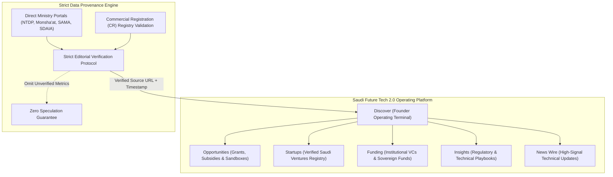
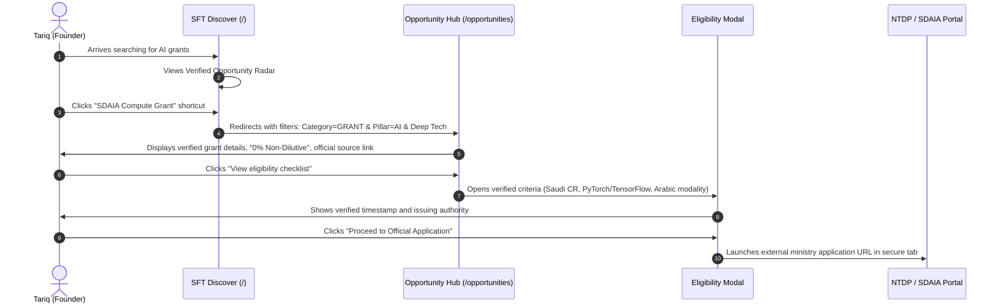
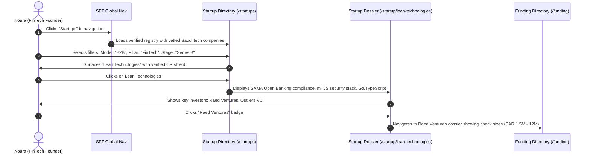
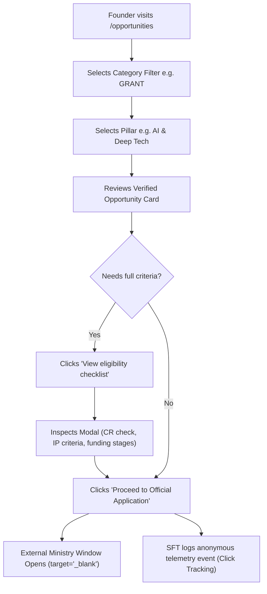

# SAUDI FUTURE TECH 2.0 — STAGE 2: PRODUCT EXPERIENCE & UX BLUEPRINT (REVISED)
**The Operating Intelligence Platform for Technology Founders in Saudi Arabia**

---

> **Document Status:** Revised with Stage 2 Review Guardrails & Awaiting Final Gate Approval  
> **Strategic Anchor:** Approved Stage 1 Research & Architecture Report  
> **Official Approved Tagline:** *"Build in the Kingdom. Powered by verified intelligence."*  
> **Primary Target Persona:** Saudi tech startup founders, technical co-founders, and cross-border entrepreneurs incorporating in KSA  
> **Execution Directive:** Planning and architecture specification only. No code implementation shall commence until this corrected scope is reviewed and explicitly authorized.

---

## 1. Executive Summary & Revised Guardrails

Following the Stage 2 review, this revised blueprint cements **Saudi Future Tech (SFT)** as a founder-first operating intelligence platform, incorporating three mandatory corrections:

1. **Uncompromising Data Integrity Protocol:** Wireframe examples (grant amounts, company metrics, funding stages, application deadlines, and tech stacks) are strictly illustrative. In production, unverified or speculative figures are never displayed or promised. Every displayed entity must possess an official source URL, an explicit last-verified timestamp, and clear visual differentiation between confirmed facts and unverified/omitted fields.
2. **Simplified, High-Performance Interaction Design:** The resource-heavy 3D cover-flow carousel is eliminated. In its place, we specify a clean, accessible, high-performance **Sovereign Pillar Navigator** that emphasizes clarity, keyboard accessibility, responsive speed, and immediate information density.
3. **Unified Brand Voice & Tagline:** All legacy or transitional slogans are retired in favor of one authoritative brand tagline throughout the product:  
   **"Build in the Kingdom. Powered by verified intelligence."**



---

## 2. Complete Product Structure & Information Architecture

### 2.1 Complete Navigation Sitemap

```
├── / (Discover — Founder Command Terminal)
│   ├── #command-search (Unified query across verified grants, startups, and intelligence)
│   ├── #opportunity-radar (Urgent non-dilutive grants, subsidies, and cohorts)
│   ├── #startup-spotlight (Verified Saudi technology ventures)
│   ├── #sovereign-pillars (High-performance 6-Pillar coverage navigator)
│   └── #briefing-dispatch (Sunday Founder Intelligence subscription)
│
├── /opportunities (Opportunity Hub & Grant Radar)
│   ├── /opportunities?category=GRANT
│   ├── /opportunities?category=ACCELERATOR
│   ├── /opportunities?category=SUBSIDY
│   ├── /opportunities?category=GOVERNMENT_PROGRAM
│   ├── /opportunities?pillar=[pillar-slug]
│   └── /opportunity/[slug] (Opportunity Verification Dossier & Eligibility Checklist)
│
├── /startups (Saudi Startup Directory)
│   ├── /startups?stage=[stage-enum]
│   ├── /startups?model=[b2b|b2c|b2g|marketplace]
│   ├── /startups?pillar=[pillar-slug]
│   ├── /startups?city=[riyadh|jeddah|tabuk|khobar]
│   └── /startup/[slug] (Verified Company Profile & Technology Dossier)
│
├── /funding (Venture Capital & Institutional Funds — Phased Rollout)
│   ├── /funding?type=[vc|sovereign|accelerator]
│   ├── /funding?regulated=true (CMA Licensed / SVC Partner filter)
│   └── /investor/[slug] (Fund Mandate, Ticket Size & Direct Pitch Dossier)
│
├── /insights (Founder Operating Intelligence & Regulatory Tear-Downs)
│   ├── /insights?topic=[regulatory|architectural|playbooks]
│   └── /article/[slug] (Longread Technical Briefing & Strategic Takeaways)
│
├── /latest (Real-Time News Wire & Technical Dispatch)
│   └── /latest (Chronological high-signal reporting)
│
├── /newsletter (Sunday Founder Briefing Archive & Subscription)
│
└── /admin (Editorial CMS & Verification Backstage)
    ├── /admin/opportunities (Manage verified grants, deadlines, criteria, source URLs)
    ├── /admin/startups (Verify CR, tech stacks, stage milestones)
    ├── /admin/investors (Track CMA licensing, check ranges, fund mandates)
    ├── /admin/articles (Authoring, peer-review, scheduled publishing)
    ├── /admin/categories & /admin/tags (Taxonomy management)
    └── /admin/subscribers & /admin/campaigns (Weekly dispatch manager)
```

---

### 2.2 Detailed Module Specifications

| Module | Core Purpose | Target User | Information Displayed (Verified Only) | Actions Founders Can Perform | Key Pages & Subroutes |
| :--- | :--- | :--- | :--- | :--- | :--- |
| **1. Discover** | Executive founder command dashboard prioritizing immediate opportunities and verified market intelligence. | Tech founders, technical co-founders, CTOs. | Real verified active grants, verified startups spotlight, high-performance 6-pillar horizontal navigator, Sunday briefing terminal. | Instant multi-entity query, filter by immediate need (e.g. non-dilutive capital), launch application flows, subscribe to weekly dispatch. | `/` |
| **2. Opportunities** | Discovery engine for non-dilutive funding, government subsidies, accelerators, compute grants, and sandboxes. | Pre-seed to Series A founders looking to extend runway without equity loss. | Grant amounts (SAR, verified only), equity dilution terms (0% vs equity), issuing ministry/incubator, countdown to closing, verified eligibility checklists, official direct links. | Multi-category filtering, pillar tagging, search by provider, expandable eligibility checklist modal, direct official application launch. | `/opportunities`<br>`/opportunity/[slug]` |
| **3. Startups** | Definitive verified registry of technology ventures founded or headquartered in Saudi Arabia. | Founders benchmarking peers, corporate procurement heads, talent, investors. | CR-verified status, HQ city, founding year, verified funding stage, business model, verified tech stacks, verifiable operating traction (unverified data omitted). | Filter by stage, business model, sovereign pillar, and tech stack tags; search by keyword; inspect deep tech architecture; visit official corporate domain. | `/startups`<br>`/startup/[slug]` |
| **4. Funding** | Directory of institutional venture capital, family offices, and sovereign co-investment funds deploying in KSA. | Seed to Series B founders actively planning or executing an institutional equity round. | Fund AUM, ticket size range (SAR & USD), target development stages, sectoral mandates, CMA licensing and SVC co-investment status, portfolio benchmarks, official pitch channels. | Filter by ticket size, target stage, and CMA regulation; identify aligned lead investors; access direct partner pitch forms. | `/funding`<br>`/investor/[slug]` *(Phased Release)* |
| **5. Insights** | Architectural playbooks, regulatory teardowns, and market research (e.g., SAMA Open Banking rules, SDAIA data residency). | CTOs, product architects, technical founders, and enterprise operators. | Deep-dive analytical essays, step-by-step regulatory navigation frameworks, sovereign cloud deployment guides, actionable founder takeaways. | Read longform analysis, review regulatory flowcharts, copy technical configurations, access cited official decrees. | `/insights`<br>`/article/[slug]` |
| **6. News Wire** | Chronological stream of factual, high-signal Saudi technology developments. | Founders, investors, and ecosystem analysts needing daily situational awareness. | Regulatory announcements, sovereign compute infrastructure updates, major venture rounds, giga-project tech milestones (NEOM, Red Sea). | Filter by vertical, inspect chronological timeline, verify source attribution. | `/latest` |

---

## 3. End-to-End User Journeys

### User Journey 1: Pre-Seed AI Founder Seeking Non-Dilutive Capital
* **Persona:** *Tariq, 29, AI software engineer in Riyadh building an Arabic conversational intelligence SaaS.*
* **Objective:** Discover verified non-dilutive government funding and GPU compute credits without facing dead links or fabricated criteria.



---

### User Journey 2: FinTech Founder Researching Competitors & Infrastructure
* **Persona:** *Noura, 34, former banking executive building an embedded B2B payroll lending platform.*
* **Objective:** Verify which competitors hold active sandbox authorization, their tech stacks, and their lead institutional backers.



---

## 4. Homepage Experience Specification

### 4.1 Differentiation Mandate
The homepage communicates immediate founder utility and rigor:
1. **Single Consistent Tagline:** Prominently displays *"Build in the Kingdom. Powered by verified intelligence."*
2. **Zero Promotional Clutter:** No clickbait headlines, no third-party advertisements, and no unverified claims.
3. **High-Performance Sovereign Pillar Navigator:** Replaces the heavy 3D cover-flow with a crisp, accessible, 6-pillar sector browser that loads instantly and provides direct access to sector intelligence.

### 4.2 Content Order & Visual Hierarchy

```
+-----------------------------------------------------------------------------------+
| 1. GRAND MASTHEAD & UNIFIED TAGLINE                                               |
|    - Brand: "Saudi Future Tech" (Codec Pro Bold)                                  |
|    - Tagline: "Build in the Kingdom. Powered by verified intelligence."           |
|    - Authority: "FOUNDER OPERATING INTELLIGENCE PLATFORM • KINGDOM OF SAUDI ARABIA" |
+-----------------------------------------------------------------------------------+
| 2. UTILITY NAVIGATION RIBBON (Fixed on scroll with smooth momentum)               |
|    [Discover]  [Opportunities (ACTIVE BADGE)]  [Startups]  [Funding]  [Insights]  |
+-----------------------------------------------------------------------------------+
| 3. FOUNDER COMMAND HERO SECTION                                                   |
|    - Value Proposition Headline (Codec Pro Bold)                                  |
|    - Unified Instant Search Input with [Explore ->] CTA                           |
|    - Quick-Filter Shortcut Chips: NTDP MVPLab | The Garage | SAMA Sandbox | VCs  |
|    - Live Metric Ribbon (Showing verified numbers only; no artificial promises)   |
+-----------------------------------------------------------------------------------+
| 4. LIVE OPPORTUNITY RADAR STRIP                                                   |
|    - Section Heading with verified radar signal                                   |
|    - 4-Card Responsive Grid (Closing soonest to newest)                           |
|    - Verified details: Authority, Grant SAR, Equity, Days Remaining, Source URL   |
|    - Action: [View All Opportunities ->]                                          |
+-----------------------------------------------------------------------------------+
| 5. VERIFIED SAUDI STARTUPS SPOTLIGHT                                              |
|    - 4 Spotlight Venture Cards (CR-verified entities only)                        |
|    - Verified shield icon, Stage pill, Verified traction metric, Tech stack tags  |
|    - Action: [Explore Full Directory ->]                                          |
+-----------------------------------------------------------------------------------+
| 6. SOVEREIGN PILLAR NAVIGATOR (Performance-First Grid)                            |
|    - Crisp 6-card architectural grid replacing legacy 3D cover flow               |
|    - Cards: AI & Deep Tech | GovTech | Cybersecurity | Smart Cities | FinTech ... |
|    - Sub-beats, active venture count, and lead regulatory dossiers                |
+-----------------------------------------------------------------------------------+
| 7. FOUNDER INTELLIGENCE & INVESTIGATIVE BRIEFINGS                                 |
|    - 3-Column Curated Deep Dives & Regulatory Frameworks                          |
|    - Reading times, Author bylines, Practical Takeaway highlights                 |
+-----------------------------------------------------------------------------------+
| 8. DATA SOVEREIGNTY & PROVENANCE GUARANTEE                                        |
|    - Midnight Navy container (#14283D) with Oasis Green and Teal badges           |
|    - 3 Columns: Zero Fabricated Data | Direct Ministry Provenance | No Paywalls   |
+-----------------------------------------------------------------------------------+
| 9. SUNDAY FOUNDER BRIEFING (Newsletter Terminal)                                  |
|    - Clean inline form: "Join founders receiving verified operating intel"        |
+-----------------------------------------------------------------------------------+
| 10. PUBLICATION FOOTER                                                            |
|    - Pillar Links, Transparency Statement, Legal CR Disclaimers, Backstage CMS   |
+-----------------------------------------------------------------------------------+
```

---

## 5. Opportunity Hub UX Specification

### 5.1 Discovery Journey & Strict Data Integrity
* **No Unverified Data:** Grant sizes, equity percentages, and deadlines are displayed only when verified against official ministerial gazettes, program terms, or signed public records.
* **Explicit Unknown Labeling:** If an accelerator has not disclosed its cohort check size, the field displays `"Undisclosed by Program"` rather than an estimate.
* **Direct Ministry Routing:** The "Apply" action always opens the authenticated ministry portal directly (`target="_blank" rel="noopener noreferrer"`).



---

### 5.2 Opportunity Listing Wireframe (`/opportunities`)
*(Sample data shown is strictly illustrative of layout structure)*

```
+----------------------------------------------------------------------------------------------------+
| Opportunity Hub & Grant Radar                                                                      |
| Discover verified non-dilutive government grants, seed accelerators, and regulatory sandboxes.    |
| • Verified Programs Only    🛡️ Zero Speculation Guarantee    🔗 Direct Official Ministry Links     |
+----------------------------------------------------------------------------------------------------+
| [🔍 Search grants, programs, organizations (e.g. NTDP, The Garage, SAMA)...                      ] |
|                                                                                                    |
| Filter by Type:                                                               Pillar:              |
| [All]  [Grants]  [Accelerators]  [Subsidies]  [Sandboxes & Gov]  [Incubators] [All Pillars       v]|
+----------------------------------------------------------------------------------------------------+
| Showing verified opportunities                             🛡️ 100% Verified with issuing authorities|
+--------------------------------------------------+-------------------------------------------------+
| [🏛️ SDAIA]  AI & Deep Tech   [⏱️ Closes in 9 days] | [🏛️ The Garage] AI & Deep Tech [⏱️ Closes in 11 d] |
| SDAIA ALLaM GenAI Sovereign Compute Grant        | The Garage Incubator & Seed Cohort              |
|                                                  |                                                 |
| 💰 Up to SAR 300,000 Compute  [0% Non-Dilutive]  | 💰 SAR 100,000 Grant + Credits  [0% Zero Dilut] |
| • Riyadh, KSA (Remote Compute)                   | • The Garage Campus, KACST, Riyadh              |
| Grants high-performance NVIDIA H100 clusters     | Flagship startup district inside KACST with     |
| and direct fine-tuning access to ALLaM.          | dedicated office suites & prototyping labs.     |
|                                                  |                                                 |
| > View eligibility checklist (4 criteria)        | > View eligibility checklist (4 criteria)       |
|                                                  |                                                 |
| Source: SDAIA Innovation Desk                    | Source: The Garage KACST                        |
| Verified: Nov 20, 2026          [Dossier] [Apply]| Verified: Nov 20, 2026         [Dossier] [Apply]|
+--------------------------------------------------+-------------------------------------------------+
```

---

### 5.3 Opportunity Detail Page Wireframe (`/opportunity/[slug]`)

```
+----------------------------------------------------------------------------------------------------+
| BREADCRUMBS: Home / Opportunities / NTDP MVPLab Grant & Acceleration                               |
+----------------------------------------------------------------------------------------------------+
| [🏛️ NATIONAL TECHNOLOGY DEVELOPMENT PROGRAM (NTDP)]                 STATUS: [🟢 ACTIVE APPLICATION] |
|                                                                                                    |
| # NTDP MVPLab Grant & Acceleration Cohort 4                                                        |
| Non-dilutive product validation capital and venture-builder partnership for Saudi tech founders. |
|                                                                                                    |
| +-------------------------+-------------------------+-------------------------+------------------+ |
| | FUNDING AMOUNT          | EQUITY TAKEN            | APPLICATION DEADLINE    | TARGET STAGE     | |
| | Up to SAR 150,000       | 0% (Non-Dilutive)       | Dec 15, 2026 (25 Days)  | Pre-Seed / MVP   | |
| +-------------------------+-------------------------+-------------------------+------------------+ |
+----------------------------------------------------------------------------------------------------+
|                                                                                                    |
| [LEFT COLUMN: 65% WIDTH]                                [RIGHT COLUMN: 35% WIDTH]                  |
|                                                                                                    |
| ## 1. Program Overview & Scope                          +----------------------------------------+ |
| The MVPLab initiative bridges early-stage Saudi         | ### Quick Application Summary          | |
| technical entrepreneurs with globally accredited        | Provider: NTDP (Ministry of MCIT)      | |
| venture builders. The program funds up to 100% of the   | Location: Riyadh, KSA (Hybrid)         | |
| technical build cost with zero equity dilution.         | Verified: Nov 20, 2026 (Editorial Desk)| |
|                                                         |                                        | |
| ## 2. Mandatory Founder Eligibility Checklist           | [PROCEED TO OFFICIAL APPLICATION ->]   | |
| [✓] Active Saudi Commercial Registration (CR) or        | (Direct link to ntdp.gov.sa portal)    | |
|     verified Saudi national co-founder status.          +----------------------------------------+ |
| [✓] Clear proprietary software architecture; no white-  |                                        | |
|     label reseller software models.                     | ### Supporting Documentation Needed    | |
| [✓] Dedicated full-time technical or product lead for   | • Pitch deck with problem statement    | |
|     the 12-week venture builder collaboration.          | • Target market TAM/SAM calculations   | |
| [✓] Commitment to incorporate entity inside KSA.        | • Architecture technical diagram       | |
|                                                         +----------------------------------------+ |
| ## 3. Program Benefits & Milestones                                                                |
| • Milestone 1: UX Wireframing & Scope Lock (SAR 40K)                                               |
| • Milestone 2: Core Engineering & Alpha Build (SAR 60K)                                            |
| • Milestone 3: Security Pen-Testing & Launch (SAR 50K)                                             |
|                                                                                                    |
| ## 4. Official Authority Verification & Provenance                                                 |
| • Issuing Entity: National Technology Development Program                                          |
| • Ministerial Oversight: Ministry of Communications and Information Technology (MCIT)              |
| • Verification Standard: Reviewed directly against NTDP Gazette Notice #2024-B                     |
+----------------------------------------------------------------------------------------------------+
```

---

## 6. Startup Directory UX Specification

### 6.1 Purpose & Data Integrity Standards
* **Mandatory CR / Sandbox Verification:** Every listed venture must possess verified Saudi Commercial Registration or a recognized SAMA/CMA sandbox license.
* **Omission of Unverified Financials:** Valuation numbers, unverified revenue, or speculative metrics are strictly excluded. Only verified operational traction (e.g. public contracts, regulated licenses, or sovereign infrastructure deployments) is permitted.
* **Technology Disclosure Verification:** Stacks are verified through public repositories, technical founder interviews, or official engineering team disclosures.

---

### 6.2 Startup Listing Wireframe (`/startups`)

```
+----------------------------------------------------------------------------------------------------+
| Saudi Startup Directory                                                                            |
| Verified registry of technology startups and scaleups building in the Kingdom of Saudi Arabia.     |
| • CR-Verified Ventures Only    🛡️ Active KSA Headquarters    ✨ Mapped to Sovereign Tech Pillars  |
+----------------------------------------------------------------------------------------------------+
| [🔍 Search startups, technologies, models (e.g. Mozn, Tamara, Rust, Open Banking)...             ] |
|                                                                                                    |
| Stage:      [All] [Pre-Seed] [Seed] [Series A] [Series B] [Series C+] [Growth]                     |
| Model:      [All Models v]                                           Pillar: [All Pillars        v]|
+----------------------------------------------------------------------------------------------------+
| Showing verified ventures                                  🛡️ Verified Saudi Headquarters & Operations|
+----------------------------------------+-----------------------------------------------------------+
| Mozn 🛡️              [AI & DEEP TECH] | Tamara 🛡️                                        [FINTECH] |
| Enterprise AI & AML Intelligence       | The First Saudi FinTech Unicorn & Shopping Super-App      |
| [Series B]  [B2B]  [📍 Riyadh] [2017] | [Series C+] [B2B2C]  [📍 Riyadh]                   [2020] |
|                                        |                                                           |
| Sovereign Arabic NLP and automated     | Premier Buy-Now-Pay-Later platform partnered with tens   |
| risk intelligence powering AML across  | of thousands of regional merchants. Backed by Sanabil.    |
| leading Gulf enterprise institutions.  |                                                           |
|                                        | ⚡ Metric: Over 10M registered users, $1B+ unicorn        |
| ⚡ Metric: 500M+ transactions processed| Tech Stack: [TypeScript] [Node.js] [Go] [React Native]    |
| Tech Stack: [Python] [PyTorch] [Kafka] |                                                           |
| Verified: Nov 20, 2026  [Dossier] [↗]  | Verified: Nov 20, 2026                     [Dossier] [↗]  |
+----------------------------------------+-----------------------------------------------------------+
```

---

### 6.3 Startup Detail Page Wireframe (`/startup/[slug]`)

```
+----------------------------------------------------------------------------------------------------+
| BREADCRUMBS: Home / Startups / Mozn                                                                |
+----------------------------------------------------------------------------------------------------+
| [🏢 COMPANY LOGO]  Mozn Technologies 🛡️ (Verified KSA Enterprise Entity)                            |
| Tagline: Enterprise AI & Sovereign Financial Crime Intelligence                                   |
|                                                                                                    |
| [📍 Riyadh, Saudi Arabia]   [Est. 2017]   [Stage: Series B]   [Model: B2B Enterprise SaaS]         |
| Sector: AI & Deep Tech (Pillar 01)        Regulatory Status: Compliant with SDAIA AI Ethics        |
+----------------------------------------------------------------------------------------------------+
|                                                                                                    |
| [LEFT COLUMN: 65% WIDTH]                                [RIGHT COLUMN: 35% WIDTH]                  |
|                                                                                                    |
| ## 1. Company Executive Summary                         +----------------------------------------+ |
| Mozn builds enterprise Arabic natural language          | ### Verified Company Metadata          | |
| processing models and automated financial crime         | Commercial Registry: Verified KSA      | |
| intelligence. Its flagship FOCAL platform powers anti-  | Headquarters: Digital City, Riyadh     | |
| money laundering (AML), automated sanctions screening,  | Company Website: mozn.sa               | |
| and fraud detection for Gulf commercial banks.          | Verified Date: Nov 20, 2026            | |
|                                                         |                                        | |
| ## 2. Core Architectural Tech Stack                     | [VISIT OFFICIAL DOMAIN ->]             | |
| • Backend Engineering: Python, FastAPI, Go              +----------------------------------------+ |
| • Machine Learning Engine: PyTorch, HuggingFace, ALLaM  |                                        | |
| • Real-Time Event Streaming: Apache Kafka, RabbitMQ     | ### Verified Operating Metrics         | |
| • Sovereign Cloud: Hosted in KSA Sovereign Data Centers | • 500M+ Banking transactions screened  | |
|                                                         | • Tier-1 Gulf banks in active prod     | |
| ## 3. Key Corporate Milestones                          | • Series B funding round complete      | |
| • 2017: Founded in Riyadh by KACST & MIT alumni.        +----------------------------------------+ |
| • 2022: Closed $10M Series A led by Raed Ventures.      |                                        | |
| • 2024: Deployed sovereign FOCAL engine across GCC.     | [CLAIM THIS STARTUP PROFILE]           | |
|                                                         | (For authorized founders with KSA CR)  | |
+----------------------------------------------------------------------------------------------------+
```

---

## 7. Founder Intelligence & Weekly Dispatch Experience

### 7.1 From "Articles" to "Operating Intelligence"
SFT Founder Intelligence produces **actionable operating briefings** containing:
* **The Architecture Breakdown:** Exact database and cloud configurations meeting SAMA and SDAIA compliance.
* **The Regulatory Playbook:** Actionable steps for navigating sandbox approvals.
* **The Funding Teardown:** Verifiable milestone benchmarks required by lead regional VCs.
* **Actionable Takeaways Box:** An executive checklist at the top of every briefing specifying immediate founder takeaways.

```
+-----------------------------------------------------------------------------------+
| 💡 SFT FOUNDER OPERATING TAKEAWAYS                                                 |
| 1. SAMA Sandbox Rule: Open banking APIs require mTLS and KSA-hosted HSM keys.     |
| 2. Timeline: Expect 14 weeks from submission to live test consumer authorization.|
| 3. Cost Benchmark: Budget SAR 45K for third-party penetration testing.             |
+-----------------------------------------------------------------------------------+
```

---

## 8. Visual Design System & Palette Specification

### 8.1 Palette Evaluation & Roles

| Color Token | Hex Code | Semantic Role | Accessibility & Contrast Ratio | Usage Rules |
| :--- | :--- | :--- | :--- | :--- |
| **Midnight Navy** | `#14283D` | Primary authority & structure | `12.8:1` on White (AAA Pass) | Main headings, primary CTAs, high-contrast container boxes, global header rules. Never use pure black `#000000`. |
| **Desert Sand** | `#F2EDE2` | Natural limestone reading canvas | Elevated neutral surface | Inset cards, search pill backgrounds, callout quote containers, subtle table header strips. |
| **Oasis Green** | `#39765B` | Verification & positive signal | `4.8:1` on White (AA Pass) | "Verified CR" badges, "0% Non-Dilutive" pills, active radar beacon indicators, success states. |
| **Digital Teal** | `#25A6A0` | Interactive technology accents | `3.6:1` on Dark Navy (AA Pass) | Active tab indicators, tech stack pills, code snippets, secondary action links. |
| **Desert Gold** | `#C69B59` | Priority deadlines & urgency | `3.2:1` large text / decorative | "Closes Soon" countdown timers, featured opportunity borders, editorial spotlight tags. |
| **Clean White** | `#FFFFFF` | Primary surface sheet | `21:1` against Navy | Clean card surfaces, modal sheets, reading paper layers. |

### 8.2 Strict Visual Anti-Patterns
1. **No 3D Cover-Flow Complexity:** Eliminated in favor of an accessible, high-performance structured grid.
2. **No Generic AI SaaS Templates:** Avoid purple gradients, floating spheres, and glassmorphism.
3. **No Excessive Rounded Corners:** Limit radii to clean architectural standards (`rounded-sm` [2px], `rounded-md` [6px], `rounded-lg` [8px]).
4. **No Government Clichés:** Do not use official royal emblems or misleading ministerial stamps.
5. **No Card Monotony:** Balance card grids with structured data tables and asymmetrical split layouts.

---

## 9. Existing Project Compatibility Audit

| Existing Subsystem | Current Codebase Status | Verdict | Action for Phased Implementation |
| :--- | :--- | :--- | :--- |
| **Admin CMS** | Full NextAuth-powered backstage with article, campaign, subscriber, and category management. | **KEEP & EXTEND** | Retain all existing CRUD routes. Expand to manage Opportunities and Startups verification. |
| **Authentication & RBAC** | NextAuth v5 with bcrypt hashing, brute-force tracking (`LoginAttempt`), and 3 roles (`SUPER_ADMIN`, `EDITOR`, `AUTHOR`). | **KEEP** | 100% reusable. Zero changes required. |
| **Article Publishing System** | Complete state machine (`DRAFT` → `IN_REVIEW` → `SCHEDULED` → `PUBLISHED` → `ARCHIVED`) with cron auto-publishing. | **KEEP & REPURPOSE** | Reused directly for Founder Insights and Technical Playbooks (`/insights` and `/article/[slug]`). |
| **Categories & Taxonomy** | 6 sovereign pillars (`cat-ai`, `cat-govtech`, `cat-cyber`, `cat-smartcities`, `cat-fintech`, `cat-cleanenergy`). | **KEEP & EXPAND** | Reused as foreign keys for `Opportunity` and `Startup` models. |
| **Newsletter Infrastructure** | `NewsletterSubscriber` model with consent timestamps, unsubscribe tokens, and campaign drafting. | **KEEP** | Reused for the **Sunday Founder Briefing**. Existing subscribers and send pipeline remain 100% operational. |
| **Homepage (`src/app/page.tsx`)** | Historical news magazine layout with legacy coverflow. | **MODIFY** | Retain Founder Command Terminal, remove 3D cover-flow complexity, unify tagline to *"Build in the Kingdom. Powered by verified intelligence."* |
| **Global Navigation (`SiteHeader.tsx`)** | Newspaper masthead with category links. | **MODIFY** | Update to Founder Intelligence hierarchy: `Discover`, `Opportunities`, `Startups`, `Funding`, `Insights`, `News`. |
| **Search Engine (`/search` & API)** | Article full-text query. | **MODIFY & EXTEND** | Extend to query across Articles, Opportunities, and Startups simultaneously. |
| **SEO & Schema.org** | Dynamic OpenGraph generators, Twitter cards, `WebSiteJsonLd`, and `BreadcrumbJsonLd`. | **KEEP & EXTEND** | Add JSON-LD schema for `FinancialProduct` (Grants) and `Organization` (Startups). |

---

## 10. Phased Implementation Scope & Approval Gate

### 10.1 Phased Implementation Roadmap

To avoid regressions, implementation is structured into independently testable stages:

* **Stage A: Homepage & Navigation Alignment**
  * Unify tagline to `"Build in the Kingdom. Powered by verified intelligence."` across all headers, heroes, and footers.
  * Replace the 3D cover flow with the accessible, high-performance **Sovereign Pillar Navigator**.
  * Remove all hardcoded or speculative metrics from hero ribbons (showing verified numbers only).

* **Stage B: Opportunity Hub & Permalinks (`/opportunities` & `/opportunity/[slug]`)**
  * Integrate strict verification flags, source URLs, and last-verified dates.
  * Implement dynamic detail dossiers with eligibility checklists and official ministry application links.

* **Stage C: Saudi Startup Directory & Permalinks (`/startups` & `/startup/[slug]`)**
  * Integrate strict CR verification and omit unverified valuation/revenue claims.
  * Implement dynamic startup dossiers with verified tech stacks, corporate timelines, and founder profile claim hooks.

* **Stage D: CMS Verification Management (`/admin/opportunities` & `/admin/startups`)**
  * Add administrative verification audit trails in the backstage CMS.

* **Stage E: Global Unified Search (`/api/search` & `/search`)**
  * Deliver multi-entity search across grants, startups, and intelligence.

* **Stage F: Funding Intelligence (`/funding`)**
  * Roll out verified venture capital and institutional fund intelligence in a subsequent phase.

---

### 10.2 Exact Pages & Components Affected

1. `src/lib/constants.ts` (Official approved tagline and navigation constants)
2. `src/components/public/SiteHeader.tsx` (Global navigation and tagline alignment)
3. `src/components/public/FounderCommandHero.tsx` (Approved tagline, remove speculative stat counters)
4. `src/components/public/EditorialPillarsSection.tsx` (Replace 3D cover flow with clean performance-first grid)
5. `src/app/page.tsx` (Homepage composition with simplified, accessible structure)
6. `src/app/opportunities/page.tsx` & `src/components/public/OpportunityDirectory.tsx` (Opportunity Radar)
7. `src/app/opportunity/[slug]/page.tsx` (Opportunity Detail Dossier)
8. `src/app/startups/page.tsx` & `src/components/public/StartupDirectory.tsx` (Startup Directory)
9. `src/app/startup/[slug]/page.tsx` (Startup Detail Dossier)
10. `src/app/api/search/route.ts` & `src/app/search/SearchClient.tsx` (Unified Search)
11. `src/components/admin/AdminSidebar.tsx` & `src/app/admin/opportunities/page.tsx` & `src/app/admin/startups/page.tsx` (CMS Verification)

---

### 10.3 Database Entities & Schema Expectations
* Current `schema.prisma` contains `Opportunity`, `Startup`, and `Investor` models alongside the existing core models (`User`, `Article`, `Category`, `Tag`, `NewsletterSubscriber`, `NewsletterCampaign`, `LoginAttempt`).
* **Zero destructive schema modifications** are required. All existing tables and data remain intact.
* In future phases, optional additive models (`StartupClaimRequest`, `OpportunityVerificationLog`) can be introduced without impacting running systems.

---

### 10.4 Strategic Risks & Testing Strategy
* **Data Speculation Risk:** Prevented by strict editorial rule: if a field is unverified, omit it or label as `"Undisclosed"`.
* **Performance & Accessibility Risk:** Eliminated by removing heavy 3D cover-flow WebGL/CSS perspective transforms in favor of native CSS grid layouts.
* **Testing Pipeline:**
  1. `npm run typecheck` (strict TypeScript compilation).
  2. `npm run lint` (Next.js ESLint verification).
  3. `npm run build` (full static generation of all 55+ routes).
  4. Puppeteer headless visual QA testing across desktop, tablet, and mobile viewports.
