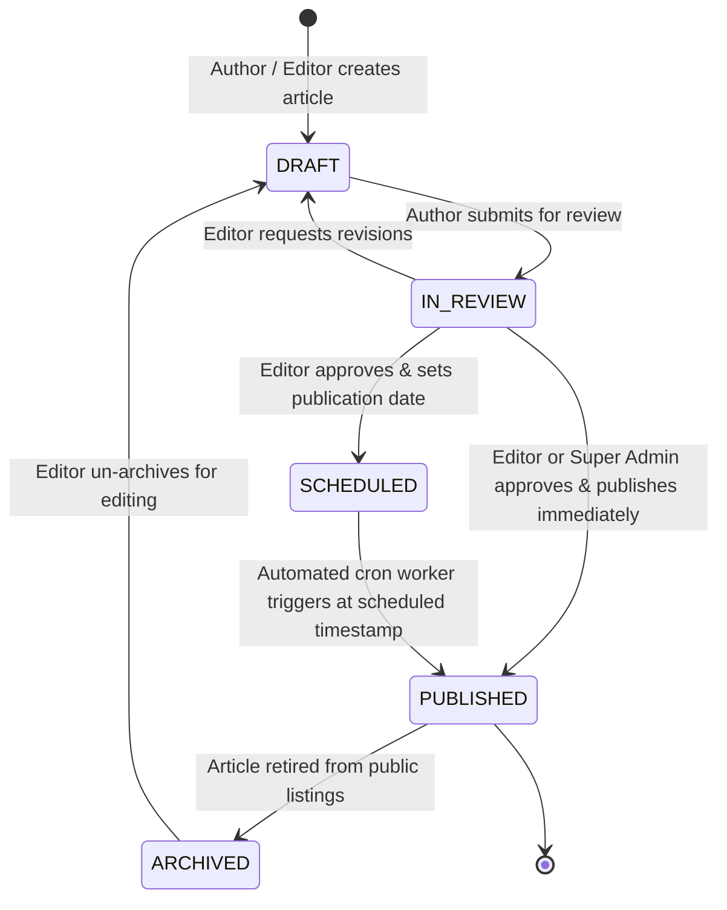
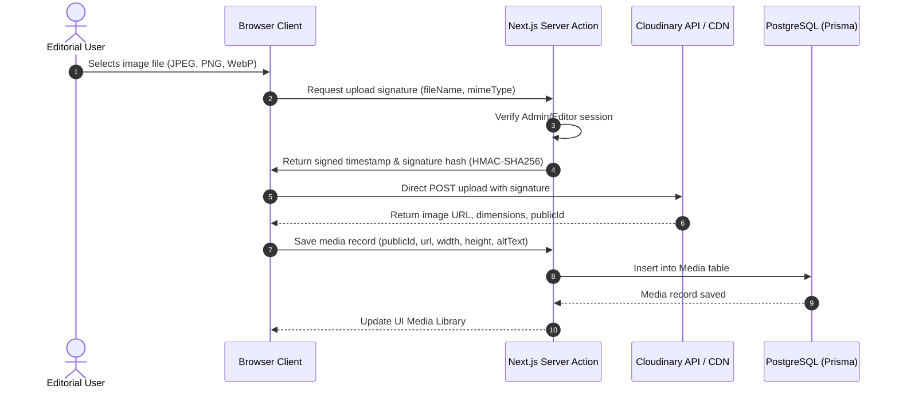

# Saudi Future Tech — System Architecture

**Document Version:** 1.0.0  
**Phase:** Phase 0 (Discovery & Architecture)  
**Status:** Approved Technical Architecture  

---

## 1. High-Level Architecture Overview

Saudi Future Tech utilizes a unified, server-rendered Next.js monolithic architecture hosted on the Vercel Edge Network, connected to a managed PostgreSQL cluster with persistent media storage on Cloudinary.

```mermaid
flowchart TD
    subgraph Clients["Clients & Edge Network"]
        Reader["Public Reader (Browser/Mobile)"]
        AdminUser["Editorial Staff (/admin)"]
        EdgeCDN["Vercel Edge Network (Global CDN / ISR Cache)"]
    end

    subgraph AppRouter["Next.js 15 Application (App Router)"]
        Middleware["Edge Middleware (RBAC & Auth Check)"]
        
        subgraph PublicZone["Public Reading Surface (RSC)"]
            HomeView["Homepage (ISR: 60s)"]
            ArticleView["Article Detail (ISR / On-Demand Tag Revalidation)"]
            CategoryView["Category Rails & Search (RSC / Suspense)"]
            StaticPages["Static Info (About, Privacy, Contact)"]
        end

        subgraph AdminZone["Admin CMS Surface (/admin)"]
            AuthMod["Auth.js v5 Session & Login"]
            Dashboard["Editorial Dashboard & Metrics"]
            ArticleEditor["Tiptap WYSIWYG Editor (Client Component)"]
            PublishEngine["Publishing & Scheduling Engine (Server Actions)"]
            MediaManager["Media Library & Direct Upload Signer"]
            NewsletterAdmin["Subscriber Management & Dispatch"]
        end

        subgraph APILayer["Server Actions & Route Handlers"]
            ServerActions["Type-Safe Server Actions (Zod Validated)"]
            RouteHandlers["REST Webhooks / Feed Handlers (RSS, Sitemap)"]
        end
    end

    subgraph DataAndStorage["Data & External Services"]
        PrismaClient["Prisma ORM Client (with Connection Pooling)"]
        PostgresDB[(PostgreSQL 16 Database)]
        CloudinaryAPI["Cloudinary CDN / Asset Storage"]
        EmailService["Resend Email API"]
    end

    Reader -->|HTTP GET (HTML/RSC Stream)| EdgeCDN
    EdgeCDN -->|Cache Miss / Revalidation| PublicZone
    AdminUser -->|HTTPS Request| Middleware
    Middleware -->|Authorized Session| AdminZone
    
    PublicZone -->|Direct DB Reads via Prisma| PrismaClient
    AdminZone -->|Server Actions| ServerActions
    ServerActions -->|Mutations & Queries| PrismaClient
    ServerActions -->|Request Signed Upload URL| CloudinaryAPI
    ServerActions -->|Dispatch Newsletters| EmailService
    ServerActions -->|On-Demand Cache Purge (revalidateTag)| EdgeCDN
    
    PrismaClient -->|Connection Pool (PgBouncer)| PostgresDB
```

---

## 2. Tiered System Layers

### 2.1. Client & Presentation Layer
* **Public Portal (Server-First):** Uses React Server Components (RSC) by default. Zero hydration overhead for standard reading pages (About, Privacy, Category archives, Static Article text). Interactive components (Search bar, Dark/Light theme toggles, Social share buttons, Newsletter signup form) are isolated into lightweight, client-side leaf components using `"use client"`.
* **Admin Portal (`/admin`):** Client-interactive rich dashboard. Leverages Radix UI primitives, dynamic tables, modal dialogs, and a rich WYSIWYG editor (Tiptap). Protected behind authentication middleware.

### 2.2. Edge & Caching Layer
* **Incremental Static Regeneration (ISR):**
  * Articles and categories are statically rendered and cached across Vercel’s global Edge nodes.
  * Stale-while-revalidate strategy: Initial responses are served instantaneously from edge cache (sub-50ms).
  * **On-Demand Cache Revalidation:** When an article is published or edited in `/admin`, the server executes:
    ```typescript
    revalidatePath(`/article/${slug}`);
    revalidateTag('featured-articles');
    revalidateTag('latest-news');
    revalidatePath(`/category/${categorySlug}`);
    ```
    This immediately purges the stale edge cache worldwide, guaranteeing readers see updates without delay.

### 2.3. Server Action & Business Logic Layer
* All data mutations (article creation, updates, category edits, user creation) are executed via **React Server Actions** located in `src/actions/*`.
* Every Server Action enforces a three-stage validation pipeline:
  1. **Authentication & Role Verification:** Asserts user session and role authorization.
  2. **Schema Validation:** Enforces strict runtime payload validation via **Zod**.
  3. **Transactional Database Execution:** Executes queries inside Prisma interactive transactions (`prisma.$transaction`) to preserve data integrity.

### 2.4. Data Persistence & Connection Pooling Layer
* **PostgreSQL:** Primary relational store.
* **Connection Pooling:** Because Next.js serverless functions scale dynamically, direct database connections could exhaust connection limits. A managed connection pooler (e.g., PgBouncer, Neon pooling, or Supabase connection pooler on port 6543) will be utilized for transaction pooling.

---

## 3. Content Publishing Workflow & State Machine

Every article progresses through an explicit, strictly enforced lifecycle state machine:



### State Definitions
1. **`DRAFT`:** Visible only to the creating author and editorial staff. Content autosaves to database. No public URL is generated.
2. **`IN_REVIEW`:** Author marks drafting complete. Notifications or dashboard alerts queue the article for editor approval.
3. **`SCHEDULED`:** Article is approved, and assigned a future `scheduledFor` UTC timestamp. A background cron job (`/api/cron/publish`) executes every 5 minutes, querying for articles where `status == 'SCHEDULED'` and `scheduledFor <= NOW()`, flipping their status to `PUBLISHED` and triggering edge revalidation.
4. **`PUBLISHED`:** Publicly accessible, indexed by sitemaps, included in RSS feeds and search vectors.
5. **`ARCHIVED`:** Removed from public index and category listings; returns HTTP 410 or redirects to category if accessed directly.

---

## 4. Authentication, Authorization & RBAC

Authentication is powered by **Auth.js (NextAuth v5)** with credentials-based authentication (Argon2 or bcrypt password hashing) and secure session tokens stored in HTTP-Only, SameSite, Secure cookies.

### Role-Based Access Control (RBAC) Matrix

| Module / Operation | Super Admin | Editor | Author | Public Reader |
| :--- | :---: | :---: | :---: | :---: |
| **Read Published Articles** | Allowed | Allowed | Allowed | Allowed |
| **Search & Filter Articles** | Allowed | Allowed | Allowed | Allowed |
| **Subscribe to Newsletter** | Allowed | Allowed | Allowed | Allowed |
| **Create Draft Article** | Allowed | Allowed | Allowed (Own only) | Denied |
| **Edit Draft Article** | Allowed | Allowed | Allowed (Own only) | Denied |
| **Submit Article for Review** | Allowed | Allowed | Allowed | Denied |
| **Publish Article Immediately** | Allowed | Allowed | Denied | Denied |
| **Schedule Article for Future** | Allowed | Allowed | Denied | Denied |
| **Delete Article** | Allowed | Denied | Denied | Denied |
| **Manage Editorial Categories** | Allowed | Allowed | Denied | Denied |
| **Manage Media Library** | Allowed | Allowed | Allowed (Upload only) | Denied |
| **Manage Featured Layouts / Hero** | Allowed | Allowed | Denied | Denied |
| **View Newsletter Subscribers** | Allowed | Allowed | Denied | Denied |
| **Export Subscriber List (CSV)** | Allowed | Denied | Denied | Denied |
| **User & Role Management** | Allowed | Denied | Denied | Denied |
| **Manage Global Site Settings** | Allowed | Denied | Denied | Denied |

### Enforcement Mechanics
1. **Middleware Layer (`src/middleware.ts`):** Intercepts all requests matching `/admin/*`. Verifies the session cookie. Unauthenticated requests are redirected to `/admin/login`. Non-privileged users are denied.
2. **Action Layer (`src/lib/auth-guard.ts`):** Helper functions `requireRole(['SUPER_ADMIN', 'EDITOR'])` run inside Server Actions before any Prisma mutation is executed.

---

## 5. Media & Asset Pipeline



* **Zero Web Server Load:** Image binary streams never touch the Next.js serverless functions, avoiding memory bloat and function timeouts.
* **Transformations on Read:** Cover images are requested using Cloudinary transformation URLs:
  * Thumbnail: `f_auto,q_auto,w_400,h_250,c_fill`
  * Hero Feature: `f_auto,q_auto,w_1200,h_675,c_fill`
  * OpenGraph: `f_auto,q_auto,w_1200,h_630,c_fill`

---

## 6. SEO, Search & Metadata Architecture

### 6.1. Dynamic Metadata (`generateMetadata`)
Every article, category, and author route implements Next.js App Router `generateMetadata()`:
* Dynamic `<title>`: `"{Article Title} | Saudi Future Tech"`
* Dynamic `<meta name="description">`: Article excerpt.
* Canonical URL: `<link rel="canonical" href="https://saudifuturetech.com/article/{slug}">`
* OpenGraph tags (`og:title`, `og:description`, `og:image`, `og:type = 'article'`).
* Twitter card tags (`summary_large_image`).

### 6.2. JSON-LD Structured Data
Published articles output standard Schema.org `NewsArticle` JSON-LD in the document `<head>`:
```json
{
  "@context": "https://schema.org",
  "@type": "NewsArticle",
  "headline": "SDAIA Unveils Next-Generation ALLaM Arabic Foundation Model",
  "image": ["https://res.cloudinary.com/.../hero.jpg"],
  "datePublished": "2026-11-14T10:00:00Z",
  "dateModified": "2026-11-14T12:30:00Z",
  "author": [{
    "@type": "Person",
    "name": "Tariq Al-Mansoor",
    "url": "https://saudifuturetech.com/author/tariq-al-mansoor"
  }],
  "publisher": {
    "@type": "Organization",
    "name": "Saudi Future Tech",
    "logo": {
      "@type": "ImageObject",
      "url": "https://saudifuturetech.com/logo.png"
    }
  },
  "description": "An in-depth analysis of the Kingdom's latest sovereign LLM breakthrough..."
}
```

### 6.3. Sitemaps and Feeds
* **XML Sitemap:** Dynamic route handler at `app/sitemap.ts` querying all published articles and categories, generating compliant XML with `<lastmod>` and `<changefreq>`.
* **Robots.txt:** Generated at `app/robots.ts`, allowing public crawling of `/article/*`, `/category/*`, `/author/*`, while disallowing `/admin/*`, `/api/*`, and `/search`.
* **RSS/Atom Feed:** Dynamic route handler at `app/feed.xml/route.ts` providing full syndication feeds for news readers and aggregators.

---

## 7. Security Architecture & Threat Mitigation

1. **Input Sanitization & Injection Prevention:**
   * Prisma ORM uses parameterized queries exclusively, eliminating SQL injection.
   * Zod validates all server inputs against strict type schemas.
   * WYSIWYG HTML output is sanitized via DOMPurify / sanitize-html before storage and rendering to eliminate Stored XSS.
2. **HTTP Security Headers:**
   Configured in `next.config.js`:
   * `Content-Security-Policy` (CSP)
   * `X-Frame-Options: DENY` (Clickjacking prevention)
   * `X-Content-Type-Options: nosniff`
   * `Strict-Transport-Security: max-age=63072000; includeSubDomains; preload`
   * `Referrer-Policy: strict-origin-when-cross-origin`
3. **Rate Limiting:**
   * Public search endpoints, contact form submissions, and newsletter signups are protected by an in-memory or Redis-backed rate limiter (Upstash Redis or token bucket) to prevent scraping and spam abuse.
4. **Authentication Brute Force Protection:**
   * Failed login attempts on `/admin/login` increment a rate-limiting counter keyed by IP address and username, locking out after 5 consecutive failures.

